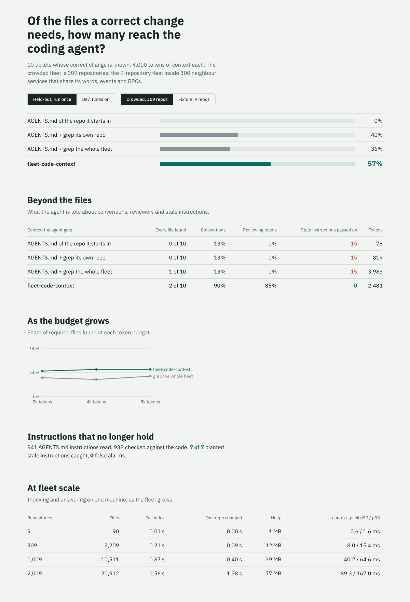

# fleet-code-context

**Context for coding agents that work across a fleet of Go services.** A ticket lands in one repository,
but the change it needs usually crosses a contract into others: the event someone else consumes, the RPC
someone else calls, the shared library everyone formats money with. An agent that greps its own checkout
cannot see those edges. An agent that reads the repository's `AGENTS.md` also follows instructions that
stopped being true months ago.

`fleet-code-context` indexes every repository of a fleet into one graph and serves it to Claude Code, Codex or
Cursor over MCP. The graph covers:

- protobuf contracts;
- who implements, calls, publishes and consumes each one;
- shared Go packages and who uses them;
- owners and reviewers;
- every `AGENTS.md`, checked against the code.

For a ticket, `context_pack` returns, within a token budget:

- the teams that own what the change touches;
- the instructions that still hold;
- the ones that no longer do, and why;
- how the contracts connect across repositories;
- the code, cut down to the declarations that matter.



## Results

<!-- dashboard:start -->
Generated by `fcc report` from `reports/`. Context sources are scored on tickets whose correct change is known: does what the agent receives contain every file the change must touch or read, the conventions it must follow and the teams that must review it, within a token budget? "Crowded" is the 9-repository fixture fleet inside 300 generated neighbour services (309 repositories, 3209 files) that share its vocabulary, events and RPCs.

**Held-out tickets, first and only run**: 10 tickets, 4,000-token budget

| Context the agent gets | Crowded fleet: files found | Every file found | Fixture fleet: files found | Conventions | Reviewing teams named | Stale instructions passed on as true | Tokens used |
|---|---:|---:|---:|---:|---:|---:|---:|
| AGENTS.md of the repo it starts in | 0% | 0 of 10 | 0% | 13% | 0% | 15 | 78 |
| AGENTS.md + grep its own repo | 40% | 0 of 10 | 40% | 13% | 0% | 15 | 819 |
| AGENTS.md + grep the whole fleet | 36% | 1 of 10 | 95% | 13% | 0% | 15 | 3983 |
| **fleet-code-context** `context_pack` | **57%** | **2 of 10** | 80% | 90% | 85% | **0** | 2481 |

**Dev tickets (the ranker was tuned on these)**: 14 tickets, 4,000-token budget

| Context the agent gets | Crowded fleet: files found | Every file found | Fixture fleet: files found | Conventions | Reviewing teams named | Stale instructions passed on as true | Tokens used |
|---|---:|---:|---:|---:|---:|---:|---:|
| AGENTS.md of the repo it starts in | 0% | 0 of 14 | 0% | 29% | 0% | 23 | 79 |
| AGENTS.md + grep its own repo | 42% | 0 of 14 | 42% | 29% | 0% | 23 | 836 |
| AGENTS.md + grep the whole fleet | 36% | 0 of 14 | 100% | 29% | 0% | 23 | 3989 |
| **fleet-code-context** `context_pack` | **84%** | **10 of 14** | 98% | 100% | 96% | **0** | 3528 |

**Files found as the budget grows** (crowded fleet, held-out tickets)

| Budget | grep the whole fleet | fleet-code-context |
|---:|---:|---:|
| 2000 tokens | 39% | 53% |
| 4000 tokens | 36% | 57% |
| 8000 tokens | 42% | 57% |

**Out-of-date instructions** (crowded fleet): 941 AGENTS.md instructions read, 938 checkable; **7 of 7 planted stale instructions caught, 0 false alarms**.

**Scale** (one machine, 2 CPUs, go1.24.7)

| Repositories | Files | Full index | One repo changed | Heap | context_pack p50 / p95 | MCP call p95 | Check every AGENTS.md |
|---:|---:|---:|---:|---:|---:|---:|---:|
| 9 | 90 | 0.01 s | 0.00 s | 0 MB | 0.6 / 1.6 ms | 2.1 ms | 0.00 s |
| 309 | 3209 | 0.21 s | 0.09 s | 12 MB | 8.0 / 15.4 ms | 15.7 ms | 0.02 s |
| 1009 | 10511 | 0.87 s | 0.40 s | 39 MB | 40.2 / 64.6 ms | 70.2 ms | 0.04 s |
| 2009 | 20912 | 1.56 s | 1.38 s | 77 MB | 89.3 / 167.0 ms | 152.9 ms | 0.11 s |

**Tests**: 17 passed, 0 failed (`go test ./...`).
<!-- dashboard:end -->

### What these numbers mean

- **The held-out tickets were written and hashed before any ranking code existed** (`config/heldout.lock`), and run
  once (`reports/heldout/first_run.json`, never rewritten). The ranker was tuned on the dev tickets only. The
  gap between dev and held-out is the honest size of that tuning: the context service finds fewer files on
  tickets it was not tuned on.
- **On a small fleet, grep is enough.** With nine repositories, reading whole files from a fleet-wide grep
  finds nearly every file within 4,000 tokens, because the whole fleet barely fills the budget. The graph earns
  its place as the fleet grows and many services share the same words: there, grep spends its budget on
  neighbours that also say "order", "rider" and "fee".
- **Files are only part of it.** Grep never names the reviewing team. It only finds the fleet's conventions if
  the file that states them happens to match the ticket's words. And it passes on every stale instruction in the
  `AGENTS.md` it starts from. The context pack carries the fleet's conventions, the owners, and a separate list
  of out-of-date instructions marked "do not follow".

### What the held-out run showed

Read from `reports/REPORT.md`. These misses are recorded as they came out, not fixed against those tickets:

- **Vocabulary gaps.** "Let customers pay with Apple Pay" reaches no payment code, because "pay" and "payment"
  are different words to a term index. Synonyms or embeddings on identifiers would close this; neither is built.
- **Contracts a ticket does not name.** "Add a PICKED_UP status" needs `orders.proto`, but the ticket never says
  "order status enum", and in the crowded fleet other services' statuses outrank it.
- **The pack stops at a score floor, not at the budget.** At 8,000 tokens it returns no more files than at
  4,000, because files below 20% of the best score are left out. A budget-aware floor would trade precision for
  recall.

## How it works

```
fleet/ (one directory per repository)
  │  index: service.yaml, OWNERS, Makefile, AGENTS.md, *.proto (services, RPCs, messages, enums, fields),
  │         *.go (go/ast: declarations, imports, selectors, method calls, bus.Publish / bus.Subscribe)
  ▼
graph of entities ── RPC ─ implemented in / called from ──────────────► files in other repositories
                  ── event ─ published by / consumed by ───────────────►
                  ── field ─ read or set in ───────────────────────────►
                  ── shared function / package ─ used in ──────────────►
  │
  ├─ drift: each AGENTS.md bullet is a claim; paths, make targets, go commands, Go symbols,
  │         import paths and units are checked against the index
  │
  ▼  context_pack(ticket, repo, budget)
rank: ticket terms → entities (by rarity, name, parent, doc) + files (text)
      → seeds, plus the edges of the best text matches
      → spread along edges, damped by fan-out, strongest tie plus a share of the rest
      → one hop into code a handler delegates to in its own repository
      → weighted by distance from the agent's repository along contract edges
pack: owners → out-of-date instructions → instructions that hold → contract edges → code snippets, within budget
```

- **Locality.** The agent's repository is the strongest signal. Repositories one contract edge away get more
  weight than the rest of the fleet: the ones whose events it consumes, whose RPCs it calls, that consume its
  events or call its RPCs. Without this, services with similar names crowded out the fleet's own contracts.
- **Fan-out damping.** An event with thirty consumers says less about any one of them than an event with two.
- **Stale instructions are not deleted, they are labelled.** The pack lists each one with the reason
  (`make lint`: the Makefile has no "lint" target; "ETAs are in minutes": the contracts carry `eta_seconds`), so
  the agent neither follows nor rediscovers them.

## Use it

```bash
make test                                    # unit tests, including the MCP protocol
go run ./cmd/fcc pack -repo notifications "The rider push says arriving in 0 minutes for short trips"
go run ./cmd/fcc who-uses RiderAssigned      # every publisher, consumer and field reader, by team
go run ./cmd/fcc check -fail                 # CI gate: fails when an AGENTS.md instruction no longer holds
go run ./cmd/fcc index -out .fcc/index.json -prev .fcc/index.json   # re-parses only changed repositories
make eval bench report                       # regenerates reports/ and the dashboard above
```

Claude Code (`.mcp.json` in a workspace):

```json
{ "mcpServers": { "fleet": { "command": "fcc", "args": ["serve", "-fleet", "/src/fleet", "-telemetry", ".fcc/telemetry.jsonl"] } } }
```

Tools:

- `context_pack`;
- `who_uses`;
- `service_card`;
- `check_instructions`;
- `search`.

All are read-only, with input schemas. Each call is logged with its tool, latency, tokens returned and whether
it failed, never the ticket text. `fcc usage` turns the log into per-tool calls, errors, latency and tokens,
the numbers to watch as teams adopt the tool.

## What is real and what is not

- **The fleet is a fixture.** It has nine Go repositories:
  - contracts, a shared library, and services for orders, dispatch, riders, payments, pricing, restaurants
    and notifications;
  - seven planted stale instructions.

  The crowded fleet adds 300 generated neighbour services. They are generated by `internal/synth` with a fixed
  seed, and share the vocabulary, consume the same events and call the same RPCs. Real fleets are messier.
- **The tickets and their required files are mine.** Each ticket lists the files a correct change must touch
  or read. Another engineer would draw some of those lines differently.
- **No live agent runs.** Coding agents could not log in from the environment this was built in, so this
  measures what the agent is given, not what it then does with it.
- **The `.pb.go` files are hand-written stand-ins** for protoc output; the parser reads real `.proto` syntax
  (proto3: services, streaming RPCs, messages, enums, comments).

## Layout

```
cmd/fcc/            CLI: index, pack, who-uses, check, serve, usage, eval, bench, report
internal/index/     repositories, proto parser, Go AST scanner, cross-repository linker, incremental rebuilds
internal/drift/     AGENTS.md claims checked against the index
internal/rank/      entity and file ranking, locality, fan-out damping
internal/pack/      context packs within a token budget
internal/mcp/       MCP server (JSON-RPC over stdio) and telemetry
internal/baseline/  what an agent gets without this: AGENTS.md, grep of its repo, grep of the fleet
internal/eval/      scoring against eval/truth (the only package that reads it)
internal/synth/     neighbour repositories for the crowded fleet and the benchmark
fleet/              the fixture fleet
eval/               tickets (dev, held-out) and truth
config/             rank.json, pack.json, heldout.lock
reports/            generated: results.json, bench.json, REPORT.md, heldout/first_run.json
web/                the results dashboard (React, Framer Motion)
```
